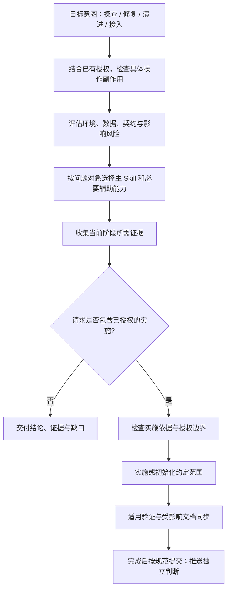

# team-standards 插件开发规范

4.11.0 起，change-readiness 与 delivery-verification 默认提供开发和验证引导。插件不再注册 SessionStart、规格/就绪写前检查及交付 Stop 检查；缺少绑定、指纹、治理 JSON 或 Forge PASS 不单独阻止作业。真实失败与未验证项仍如实报告，项目独立配置的 CI、权限和 Forge 门禁由项目决定。

已授权业务开发先按项目优先的 openspec-auto 判断规格深度，再复用[按影响判定](plugins/team-standards/skills/change-readiness/references/impact-routing.md)：规格、概设、详设与验证分别决定。仅受影响设计进入发现、补建和同步；绑定治理由项目明确选择；不因业务代码修改或历史文档缺失补齐全模块，不要求用户填写 JSON。相关任务默认共享分配分支，以原子 Commit 隔离。

概设按业务读者组织八章，详设按稳定功能编号组织九项；固定结构按影响裁剪深度，规划、实现、验证与上线分开。业务内容治理沿用既有绑定与生命周期，可选 content v1 渐进接入；机器检查结构、关联与新鲜度，具名审阅判断业务表达及设计正确性。详见[内容契约与完整样衣示例](plugins/team-standards/skills/change-readiness/references/design-output-contract.md)。

> 首次进入仓库或上下文缺失时读取本文件；同一作业可复用已读且仍适用的内容。团队插件只保留跨项目稳定能力；项目特有架构、路由、脚手架和拓扑规则必须由实际项目声明。

生产 Web UI 的重大新建或改造由 `frontend-excellence` 先明确 Page Anatomy、比较密度、移动端首个有用内容与滚动归属；业务看板由 `business-visualization-advisor` 决定是否使用图表。证据、审查与 Eval 见[企业 UI 失败模式](plugins/team-standards/skills/frontend-excellence/references/enterprise-ui-failure-patterns.md)，不把个别项目尺寸写成通用阈值。

概设详设的清晰表达统一使用 [clear-design-docs](plugins/team-standards/skills/clear-design-docs/SKILL.md)：逐段试讲、复杂对象配关系图、ER 对象与模型一致、同表层级用自关联且框内保留关键字段中文说明、接口字段有中文说明、简化措辞保持语义。结构和生命周期继续遵循设计内容契约。

架构图统一使用 [architecture-diagram-design](plugins/team-standards/skills/architecture-diagram-design/SKILL.md)：按受众选择 L1 汇报、L2 设计或 L3 实施视图，组织语义、布局、图形与配色；后续架构说明图默认沿用已确认三套模板的形象化风格，用主体、支撑资源和注释形成主次；draw.io 优先复用内置 iOS7 Icons，同图统一图标；实际打开并抽查图标改色/缩放、文字与连线，不默认要求逐笔画拆分。不把可选步骤画成必经流程，也不把规划画成已实现；沿用项目格式，不另建同职责美化 Skill。

独立审查概设、详设或技术方案使用 [reviewing-design-plainly](plugins/team-standards/skills/reviewing-design-plainly/SKILL.md)：核实当前事实，只指出本期实质缺口、矛盾与未决选择；未来规模和冷门场景以提醒为主，不以扩展设计充当评审结果。表达问题按需叠加 clear-design-docs；不新增机器阻断或审批。

提交 Hook 仅检查可静态取得的消息合同，统一接受 Bash.command 与 exec_command.cmd；不以 staged 文件数、行数或调用过某个 Skill 作为准入条件。隔离 Agent 任务的运行方法与证据见[行为回归](docs/maintenance/behavior-regression.md)，结构测试通过不等于任务效果改善。

## 工程使命

以最小复杂度，持续交付可靠、可维护的软件。[工程宪法](plugins/team-standards/skills/change-readiness/references/engineering-principles.md)统一维护共同准则与证据分工。23 个 Skill 入口聚焦目标、专项判断、必要约束和精炼反例；格式、命令与采用条件保留在所属参考，按需读取。固定结构只服务实际契约，不把这些段落当作用户回复模板；安全、权限、数据完整性和项目明确采用的质量要求继续适用。

## 分层维护入口

功能名代替需求或方案未定时，用 [architecture-reasoning（悟道）](plugins/team-standards/skills/architecture-reasoning/SKILL.md) 分清真实目标、候选实现和必要约束，选择最小充分方案；既定方案和明确小改直接推进。面向人的说明用 [plain-writing（人话）](plugins/team-standards/skills/plain-writing/SKILL.md) 整理表达，不反向重开设计。阶段、文档和验证按实际影响，不新增同职责 Skill、固定回显或机器门禁。

Agent 负责证据理解和实施，Skill 提供操作方法，Forge 负责上下文、执行状态、策略和硬约束，Hook/MCP 连接宿主。全局认知原则与本仓维护约定分开；本文件保留项目入口，不复制 Forge 实现。

- Skill 方法与代码定位：`skills/change-readiness`，上下文充分后开始实施。
- 运行时调用与版本兼容：[执行适配协议](plugins/team-standards/skills/change-readiness/references/execution-adapter.md)。
- 新版宿主接入：`hooks/session-init.js`、`hooks/check-spec-resolution.js`、`hooks/forge/client.js`。
- 分支、写入权、执行与验证策略：关联 Forge `execution/`；v1 私有文件兼容仅在 `hooks/forge/legacy-v1.js`，不继续添加新规则。

## 统一主流程

### Forge 架构套件联动维护

本节仅约束套件源码维护，不将 Forge 项目路径写进通用插件。涉及 Forge 联动的组件职责、规格/概设详设触发、上下文或证据流、任务分支策略、MCP/Hook 门禁及验证交付生命周期发生重大变化时，必须在同次作业中同步关联 Forge 仓库的 `docs/ai-coding-architecture.md`，包括受影响正文、流程图和能力边界，并分别提交关联仓改动。该文件是整体协作说明的唯一权威载体；具体触发与豁免遵从其“维护契约”，不复制另一份套件总架构。

普通修复、措辞或不改变联动契约的内部调整，在提交正文说明无架构影响即可。关联 Forge 仓库不可访问时明确待同步项，不宣称整套交付完成；无需用户重复提出更新文档，不额外授予重启或发布权限。

### 开发主流程



主流程原则：

1. `openspec-auto` 统一判断 L1/L2/L3 规格深度，项目内置版本优先；高风险强制 L3，开发中发现扩大风险即升级，不重复分级或初始化。L1 直接开发验证，L2 轻量计划，L3 复用项目 OpenSpec；项目明确要求的更严格流程继续适用。`change-readiness` 是实施准备方法入口，Forge 负责适用策略与执行裁决；先探索既有规格与实现，再判断行为影响。行为变化复用或创建相关 change，行为保持且有证据时无需空 change；M/L 风险不自动要求全部文档，概设与详设独立按影响维护。
2. `bug-doc-required` 是 Bug 唯一入口，覆盖证据、根因、最小修复和回归；未获修复授权时只调查。简单 Bug 不另建报告，复杂或高风险问题复用唯一持久记录，图表和独立报告按需生成。
3. `backend-evidence` 是单服务后端证据唯一入口；代码事实和反向影响使用 Graphify 即时查询，不维护第二套手工索引。
4. `markdown-writing-standards` 维护唯一文档归属、Markdown/Mermaid 结构与受影响的已有导航。
5. `init-project-docs` 在当前目录幂等初始化六层 AI 工程入口、`.graphifyignore` 与 Graphify Git 共享边界，并覆盖通用项目 onboarding 与上下文状态；不生成平行事实投影。
6. 小改按风险缩短流程，但不得跳过通用编码规范；项目专属规则由项目内 Skill 或 `AGENTS.md` 叠加。
7. Graphify 提供带新鲜度边界的当前实现事实，OpenSpec 提供项目行为规格与活动变更；Skill 提供意图路由与质量引导，不复制图谱或建立平行规格。
8. OpenSpec 文档按阶段准出和当前切片推进；change-readiness 维护概设详设、评审意见及交接，delivery-verification 提供真实验证。共享治理检查器检查绑定、范围、视图及证据新鲜度，仅由明确采用治理的项目按需运行，插件默认不注册此检查；同步归档仍使用官方 OpenSpec。
9. AI 原生作业将实现、受影响文档和提交作为同一交付单元：每次更新核对 README 与规则入口，按逻辑单元执行 Task → Implement → Verify → Commit → Next Task，不把多个独立任务合成一个提交，也不按技术层拆碎同一功能。文档影响规则归 markdown-writing-standards，自动提交及例外归 git-commit-standards；本地 commit 与 push 分别判断授权。
10. 工作台响应式验收同时检查可用宽高、容器高度链及滚动归属，覆盖高屏、矮屏、窄屏和动态窗口变化；正文限宽不能默认限制整个操作区域。实施与真实浏览器证据统一归 `frontend-excellence` 的 [可用视口契约](plugins/team-standards/skills/frontend-excellence/references/quality-gates.md#workspace-viewport-contract)，不新增仅匹配 CSS 类名的形式门禁。

状态契约治理复用现有四个 Skill：change-readiness 登记状态与影响，backend-evidence 核对存储及不变量，business-logic-orientation 定位消费者，delivery-verification 检查实际执行证据。共享入口为 `plugins/team-standards/scripts/state-contract.js`；按 [接入协议](plugins/team-standards/skills/change-readiness/references/state-contract.md) 逐模块启用，不将静态检查等同业务正确。

## 最小文档与证据

测试覆盖独立风险，验证采用最小充分范围。新增测试前先核对已有套件与覆盖，准备过程尽量复用且保持可变状态隔离；规则归 [测试资产与原生工具](plugins/team-standards/skills/coding-standards-common/references/testing-assets.md)。构建隐式检查计入证据，task 完成、提交、轮次、Forge 进度回报和归档不单独触发重验；相关代码、测试、配置、依赖或环境输入改变时重验对应风险及消费者。范围选择、复用边界及 Starter/HTTP 示例统一归 [delivery-verification](plugins/team-standards/skills/delivery-verification/SKILL.md#执行范围与证据复用)，不新增测试配额、扫描器或阻断。

模块当前概设/详设与活动 change 分别维护已实现基线和独立目标增量。每次功能变更核对影响，已验证切片交付前同步相关当前章节；模块绑定、指纹和接入统一采用 [当前设计基线协议](plugins/team-standards/skills/change-readiness/references/current-design-baseline.md)，不把整模块追加到永久 change，也不把规划或代码完成写成生产部署。

默认复用新鲜 Graphify 的实现关系、OpenSpec 的行为与活动变更、实际测试/运行结果；领域知识、架构决策及运行手册保留独有事实。未启用 OpenSpec 时只维护一份仓内设计，不生成独立 coding 摘要、ai-ref 或个人目录 Phase-A/B 索引；历史文档按需读，不自动迁移、删除或刷新 00–10 树。Git 是日常作业日志，日报仅按明确约定生成。具体归属与例外由 markdown-writing-standards 维护。

## 意图、授权与风险

按“目标意图 → 已有授权与具体操作副作用 → 影响风险 → 主 Skill → 必要阶段与交付”判断。四类意图用于理解结果，不直接授予权限、不直接指定 S/M/L，也不要求用户做四选一。

| 意图 | 目标与主入口 |
|---|---|
| 修复 Repair | 恢复预期行为，进入 bug-doc-required；区分只调查与已授权修复 |
| 演进 Evolve | 功能、纯重构、性能提升及规则维护；实施前进入 change-readiness，纯文档编辑直接使用文档规范 |
| 接入 Bootstrap | init-project-docs 的状态检查、初始化、配置或刷新；status 不自动升级为 init |

- 结合当前请求、上下文和已有授权理解目标，不以单个关键词决定实施。“评估是否迁移”不自动创建实施 change；“查明并修复”已包含调查和修复授权，证据与实施依据充分后连续推进。
- 按具体操作的副作用、可逆性、目标环境与数据范围判断边界。只读查询也可能有生产负载或敏感信息风险；Shell 既能查询也能修改，READ/WRITE/EXECUTE 标签不能替代操作判断。
- 风险独立评估。探查不默认 S，修复不默认可写或免规格，接入不自动获得业务代码、部署或外部写入授权。已有明确授权持续有效；仅对超出范围、尚未授权的破坏性操作、未决业务选择或无法消除的歧义补充确认，不因 M/L 或阶段切换重复审批。
- 纯重构以可观察行为、接口、状态、数据与依赖事实判断；使用相关回归或必要的特征测试验证，不凭自称免门禁，也不一律增加 PRD 或 AST 检查。OpenSpec 与风险简化路径仍按 change-readiness 执行。
- 探查默认直接交付答案与证据，不改项目、不创建实施 artifacts。用户要求文档或确有长期复用价值时在授权范围内维护唯一载体；不为分类结果新建报告。特定平台已有证据账本协议仍遵守，不复制另一份报告。
- 提交、日志、文档同步和验证是交付动作；用户单独请求时直接进入对应 Skill。混合任务按证据推进阶段，完成当前授权范围即可交付，不强行进入后续实施。
- 这些是 Agent 路由义务，不是物理隔离。Hook 受宿主与工具覆盖限制；真实访问限制由宿主权限、凭据和沙箱落实，不能声称仅拦 Edit/Write 就阻止了所有副作用。

## 主动触发表

此表用于按意图选择能力，不要求每次 Edit/Write 重读全部规范。已有依据充分时直接实施，辅助 Skill 仅在遇到对应问题时展开。

| 用户意图或动作 | 调用 Skill / 模式 |
|---|---|
| 功能名代替需求、方案取舍、阶段规划或担心过度设计 | `architecture-reasoning`（悟道）；分清目标、候选实现和约束，再判断最小充分方案；明确小改不加阶段 |
| 面向人的说明、去套话或要求说人话 | `plain-writing`（人话）；按载体改表达，保护事实和技术决策 |
| 跨项目规划或估算 | 使用项目声明的证据源；Forge 专属协议不在通用插件内 |
| 初始化、评审设计或记录明确视觉偏好 | `design-system` 的对应模式；已有设计资产优先 |
| 业务术语歧义 | `business-logic-orientation` 的术语模式 |
| 用户要求批量清理注释或纠正规范 | `coding-standards-common` 的对应模式 |
| 用户要求工作汇总 | `git-commit-standards` 的工作汇总模式 |
| 已授权实施的方案、需求、重构或源码修改 | 项目优先的 `openspec-auto` 分级；`change-readiness` 准备实施，不重复分类 |
| 只咨询方案可行性、审查或影响 | 按问题对象探查；不自动进入实施 |
| 报告 Bug、异常、超时、错误行为；或明确要求修复 | `bug-doc-required` |
| 重构、复写、迁移前理解现有业务 | `business-logic-orientation` |
| 从原始代码和数据库还原业务模型，或按业务问题补本体、关系、状态和口径 | `business-ontology-modeling`；优先复用Graphify及数据库工具，按需叠加现状理解、后端证据和变更准备 |
| 开始写业务代码 | `architecture-ddd-lite-fullstack` |
| 任何源码 Edit/Write | `coding-standards-common` |
| Java 源码 | `java-coding-standards` |
| Go 源码 | `go-coding-standards`；业务代码叠加 DDD-lite 的 Go 章节 |
| LLM SDK、Agent、Prompt、工具调用或结构化模型输出 | `llm-agent-coding-standards` |
| 创建、重做或显著提升生产 Web 前端 | `frontend-excellence`；视觉一致性复用 `design-system` |
| Web 业务图表、指标概览、管理看板创建、改造或选图评审 | `business-visualization-advisor`；先业务语义与信息设计，再视觉系统和前端实现；优化统计总览/看板时编码前形成目的—指标—图表—行动映射及选图清单，完成前反向验证业务改善 |
| 后端表、SQL、状态、字段、事件、API、领域闭环或查询性能 | `backend-evidence` |
| 编写或精简概设详设 | `clear-design-docs` 配合现有设计内容契约 |
| 绘制、重绘或美化架构说明图，包括 draw.io/drawio | `architecture-diagram-design`；统一信息提炼、三级视图、视觉语言、原生模板与轻量验收；文档正文仍按 `clear-design-docs` |
| 独立评审概设、详设、技术方案或实施方案 | `reviewing-design-plainly`；表达与图示问题按需叠加 `clear-design-docs` |
| 套件或项目更新的文档同步；新建或结构性修改 Markdown、Mermaid、复杂表格 | `markdown-writing-standards` |
| 初始化 AI 工程结构/AI 目录；初始化新项目、一键 onboard、接入新系统；或刷新上下文状态 | `init-project-docs` |
| 可执行改动完成、准备最终回复 | `delivery-verification` |
| 本次作业完成且有可提交改动；任何 git commit 或生成提交信息 | `git-commit-standards` |

## 改动规模与流程档位

| 档位 | 判定 | 最小链路 |
|---|---|---|
| S | 影响明确、容易回退，现有验证能覆盖 | 确认落点 → 最小变更 → 针对性验证 |
| M | 局部行为变化，消费者与失败路径可确定 | 维护受影响规则 → 实施 → 对应风险验证 |
| L | 关键不变量、不可逆迁移或共享契约存在实质风险 | 核实影响与必要消费者 → 明确失败及恢复 → 实施验证 |

档位决定分析深度，不决定文档配额或审批。文件数、行数、新类和新表数不单独触发升档；规格、概设、详设独立按影响维护。发现新风险只补对应依据，不停止可确认的授权工作。详见[风险判断](plugins/team-standards/skills/change-readiness/references/classification.md)。

## Skill 分类

- 分析：change-readiness、reviewing-design-plainly、bug-doc-required、business-logic-orientation（含术语）、business-ontology-modeling。
- 编码：architecture-ddd-lite-fullstack、coding-standards-common（含清理/反馈）、java-coding-standards、go-coding-standards、llm-agent-coding-standards。
- 前端设计：business-visualization-advisor（指标与信息设计）、design-system（视觉系统）、frontend-excellence（实现与验收）；业务事实仍归现有证据入口。
- 证据与接入：backend-evidence、init-project-docs、markdown-writing-standards。
- 交付：delivery-verification、git-commit-standards（含按需工作汇总）。

## 本仓维护

新增/移除 Skill 或改变核心规则时按 [决策记录](docs/maintenance/decision-log.md) 留下原因；此规则仅适用于套件维护。Forge 专属协议保留在 [平台集成区](docs/platform-integrations/planning-evidence-discovery/SKILL.md)，不作为通用插件能力加载。

## Skill 索引

| Skill | 核心职责 | 关键模式或边界 |
|---|---|---|
| `architecture-reasoning` | 悟道：需求求真、最小充分方案与升级条件 | 尊重明确选择；不为已定方案或小改重开设计 |
| `plain-writing` | 人话：读者、载体与具体表达 | 后置表达；不改变事实、契约与技术决策 |
| `architecture-ddd-lite-fullstack` | 跨语言 DDD-lite 分层、Feature 边界、语义分包、单向依赖和原子能力 | 项目具体分层例外由项目声明 |
| `backend-evidence` | 单服务后端事实、DDL/SQL 正确性与性能、反向影响、领域规格 | 跨项目拓扑不归团队插件 |
| `bug-doc-required` | Bug 证据、根因、修复合同、最小修复与回归 | 调查模式不改源码；简单问题不强制独立文档 |
| `business-logic-orientation` | Graphify 优先的现状理解与业务语义核实 | 仅明确要求或需要长期基线时生成梳理文档 |
| `business-ontology-modeling` | 从代码与数据库或业务问题推导对象、属性、关系、规则和回验 | 优先成熟工具；无知识库可起步，三个模板和六问案例，来源/接入/口径分别核实，按实际框架交付语义、Schema与领域事实 |
| `coding-standards-common` | 跨语言命名、结构、异常、重复、测试和注释规则 | 按当前代码问题使用，已读规则可复用 |
| `change-readiness` | 规格/设计/验证独立判定、既有资产复用和代码定位 | 行为保持允许无需 Change；相关任务默认共享分支 |
| `delivery-verification` | 完成前真实验证、有限修复循环与 按影响验证与如实交付 | 按影响范围选择真实验证，复用覆盖输入未变的证据 |
| `business-visualization-advisor` | 业务对象/状态、指标口径、洞察、选图与看板信息设计 | 不承担运行时引擎；普通页面不触发 |
| `frontend-excellence` | 生产 Web 前端架构、视觉、响应式、可访问性和浏览器验收 | 不用于纯后端或无布局小改 |
| `git-commit-standards` | 让提交用大白话记录原问题、关键做法、实际结果及真实 Author | 每次 commit 前调用；机器只检查三段结构，内容由提交者核实 |
| `init-project-docs` | 当前目录 AI 结构初始化、通用项目接入、上下文刷新与状态检查 | structure 创建最小入口和 Graphify 输入/共享边界；init 再编排真实工具，不复制 Graphify/OpenSpec |
| `java-coding-standards` | Java 与关系库独占规范 | 叠加 common |
| `go-coding-standards` | Go 包、接口、错误、并发与验证规范 | 叠加 common；架构复用 DDD-lite |
| `llm-agent-coding-standards` | LLM/Agent 信任边界、确定性契约和循环兜底 | 仅 LLM 集成代码触发 |
| `clear-design-docs` | 通俗表达、关系图、字段中文说明与语义保持 | 不覆盖设计结构、生命周期或授权边界 |
| `architecture-diagram-design` | 架构表达、L1/L2/L3 视图、视觉语言、三套 draw.io 模板与轻量验收 | 交付原生可编辑源图；不代替架构决策，不新增绘图引擎或门禁 |
| `reviewing-design-plainly` | 当前范围内的矛盾、关键缺口、未决前提与过度设计审查 | 未来规模与冷门场景默认提醒，不新增硬门禁 |
| `markdown-writing-standards` | 唯一归属、Markdown/Mermaid 结构与必要导航 | 不强制新建索引或日报 |

## 辅助资源索引

| 资源 | 所属 Skill | 用途 |
|---|---|---|
| `skills/change-readiness/references/engineering-principles.md` | `change-readiness` | 工程宪法：共同目标、判断准则与必要边界，其他入口引用而不复制 |
| `skills/architecture-reasoning/references/examples.md` | `architecture-reasoning` | 条件与精炼反例，按需校准需求和复杂度判断 |
| `skills/change-readiness/references/solution-review.md` | `change-readiness` | 方案与生产风险审视 |
| `skills/change-readiness/references/classification.md` | `change-readiness` | S/M/L 与模板选择 |
| `skills/change-readiness/references/document-workflow.md` | `change-readiness` | 设计文档查找、命名和更新 |
| `skills/change-readiness/references/code-orientation.md` | `change-readiness` | 实施前代码坐标与约束 |
| `skills/change-readiness/references/openspec-lifecycle.md` | `change-readiness` | OpenSpec change 自动匹配、创建、更新、验证、同步与归档判定 |
| `skills/change-readiness/references/design-output-contract.md` | `change-readiness` | 适用概设详设视图、唯一正文与长期设计晋升 |
| `skills/change-readiness/references/governance-checker.md` | `change-readiness` | 任务绑定、JSON 证据、写前/Stop/CI 检查与支持边界 |
| `skills/business-logic-orientation/references/orientation-document-workflow.md` | `business-logic-orientation` | 仅在需要长期基线时加载的完整现状文档流程 |
| `skills/business-ontology-modeling/assets/templates/`、`references/` | `business-ontology-modeling` | 问题与证据、领域模型、实施回验模板；跨项目采用、新品六问及Agent/MCP消费分工 |
| `skills/bug-doc-required/template.md` | `bug-doc-required` | 按需分析模板，不作为每次 Bug 的必填报告 |
| `skills/bug-doc-required/references/repair-rules.md` | `bug-doc-required` | 最小修复与回归证据，编码风格复用 common |
| `skills/backend-evidence/references/` | `backend-evidence` | 存储路由、更新、SQL 正确性、性能、反向影响和领域规格 |
| `skills/git-commit-standards/references/commit-details.md` | `git-commit-standards` | 按需提交示例与插件版本细则 |
| `skills/markdown-writing-standards/references/markdown-format.md` | `markdown-writing-standards` | 按需 Markdown/Mermaid 格式检查 |
| `skills/markdown-writing-standards/references/document-index-workflow.md` | `markdown-writing-standards` | 唯一归属与必要导航 |
| `skills/clear-design-docs/references/examples.md` | `clear-design-docs` | 对象关系、规则拆分与术语替换反例 |
| `skills/architecture-diagram-design/assets/templates/`、`references/` | `architecture-diagram-design` | 三套 draw.io 模板、自带图标对照、视觉主次、格式操作及四案例轻量验收；自建图标仅备用 |
| `skills/init-project-docs/references/` | `init-project-docs` | onboarding、权威来源刷新与可选轻量画像流程 |
| `skills/init-project-docs/references/initialization-output.md` | `init-project-docs` | structure/init 的完整初始化清单、保留策略和不生成边界 |
| `skills/init-project-docs/onboard-pipeline.mjs` | `init-project-docs` | 九阶段可续跑状态与关卡脚本 |
| `skills/init-project-docs/init-ai-structure.mjs` | `init-project-docs` | 当前目录六层 AI 工程结构的 plan/apply/status 初始化器 |
| `skills/init-project-docs/assets/project-ai-structure/` | `init-project-docs` | 写入目标项目的最小 Agent、Docs 与 OpenSpec 模板 |

## 插件维护规则

1. 新增、删除或改变 Skill 核心行为时，同步本文件、`README.md`、`docs/skill-flow.md` 和 `docs/dev-log/{YYYY-MM-DD}.md`。
2. `AGENTS.md` 由本文件生成；修改后运行 `node scripts/sync-agents.js`，不要直接编辑 `AGENTS.md`。
3. 破坏性删除或重命名递增 Major；三个 manifest 版本必须一致：marketplace、Claude plugin、Codex plugin。
4. 项目专属编码规范、URL 路由、模块脚手架、架构 lint 和跨项目生态拓扑不进入本插件。
5. 辅助细则放 `references/`，必要的可复用资产放 `templates/` 或 `assets/`；能够引用权威来源时不创建模板副本，只有用户意图级入口才建立独立 Skill。
   共同原则优先引用工程宪法；新增固定步骤、模板或强制措辞须说明所保护的具体契约或风险，不能把单个案例推广成所有任务的默认流程。
6. 每次套件更新按文档同步规则检查中文与英文 README、组件版本与数量、用法、流程和套件总览；受影响文档在同次作业中修正。完成验证后自动提交本次改动，不积压；明确禁止提交、无改动或验证失败等例外按提交 Skill 处理。

## 发版校验

本地按 [delivery-verification](plugins/team-standards/skills/delivery-verification/SKILL.md) 的变更影响表选择检查；CI 保留以下完整回归。Skill 指令不是纯说明，资源移动需安装测试，影响不明时扩大验证。

```bash
(cd plugins/team-standards/hooks && npm run test:full) && \
node scripts/sync-agents.js --check && \
node scripts/check-cross-refs.js && \
node scripts/check-version-sync.js && \
node scripts/audit-skills.js --warnings --ci
```


日常快测使用 `npm run test:fast --prefix plugins/team-standards/hooks`，仅检查轻量契约，不能替代变更相关集成测试。维护脚本回归使用 `node --test scripts/tests/workspace-maintenance.test.mjs`。临时输出只放仓库根 `.logs/`、`.tmp/` 或系统临时目录，不放插件载荷和工程顶层。

跨仓共享源与消费者路径唯一登记在 `scripts/shared-contracts.mjs`；先运行 `scripts/sync-shared-contracts.mjs --workspace <team-tools>` 预览，明确写入时加 `--write`，拒绝覆盖消费者未提交改动。消费者变更仍按自身运行载荷升版、验证和提交。维护根总览时先运行 `scripts/sync-workspace-overview.mjs --workspace <team-tools> --write`，再通过 `scripts/check-version-sync.js --workspace <team-tools>` 校验。详细边界以 README 维护章节为准。

## Existing Spec Resolution

已有功能变更在创建 Capability/Delta 前按[解析协议](plugins/team-standards/skills/change-readiness/references/existing-spec-resolution.md)找回 Requirement。薄 Hook 调用已配置的外部 resolver，不复制 Graphify 或规格分类算法；默认 warn，真实宿主验收后启用 block。
