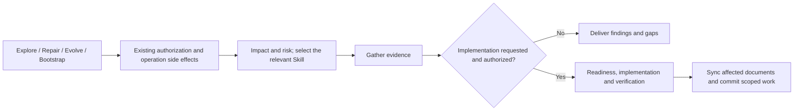

# team-standards

**5.7.0** adopts [visual briefs with on-demand implementation references](plugins/team-standards/skills/markdown-writing-standards/SKILL.md#图解主稿与按需详查). Meeting material uses message headlines, editable draw.io diagrams, key trade-offs and decisions. Detailed designs retain implementation contracts; Quickstarts show what the consumer writes and how to verify the first scenario. New [meeting](plugins/team-standards/skills/clear-design-docs/assets/meeting-brief.md) and [Quickstart](plugins/team-standards/skills/markdown-writing-standards/assets/quickstart.md) templates replace repetitive outlines. Select prototypes, object models and sequences for the actual question; existing governed design bindings remain compatible.

Earlier release notes (current Skill instructions take precedence):

**5.6.2** extends meeting briefs with business objects and table models: show object meaning, key states, relationship cardinality, ownership and storage mappings through editable draw.io object/ER diagrams. Reference shared models instead of repeating them per page; keep model questions beside the relevant business area.

**5.6.1** adds a [project meeting mode](plugins/team-standards/skills/clear-design-docs/references/meeting-brief.md) to clear-design-docs. Summarize feature lists and designs by business area, pairing prototype screenshots with editable draw.io logic or sequence diagrams, brief explanations, and questions directly below each area. Keep detailed IDs and acceptance criteria in the source documents; no new Skill or approval workflow.

**5.6.0** Initialization now organizes existing business knowledge, fills gaps from code with pending-confirmation labels, and delivers one draw.io panorama and preview alongside the project.

**5.4.3** keeps the Excel feature list compact with thumbnails. Click an image or its link to open a matching full-size view inside the workbook, then return to the list. Verify navigation, positioning, and readability.

**5.4.2** embeds readable prototype images directly beside each feature in Excel. Use multi-row blocks when needed and show related states side by side; external image links are supplementary.

**5.4.1** simplifies [page delivery planning](plugins/team-standards/skills/page-delivery-plan/SKILL.md) to an overview diagram and a five-column feature list with completion criteria in each row. Group related actions by page and user outcome. When a prototype exists, Excel includes matching screenshots and full-image links for each feature. Platform-owned sign-in, menu permissions, and resource permissions stay outside the page plan; summarize relevant data scope once. Detailed execution and test tables are optional.

**5.4.0** adds [page delivery planning](plugins/team-standards/skills/page-delivery-plan/SKILL.md). It organizes requirements, prototypes, and existing pages into an overview diagram, a feature list, and execution and acceptance details for the current delivery batch. People and AI continue from the same authoritative tasks, with optional Excel exports.

**5.3.0** adds [database design](plugins/team-standards/skills/database-design/SKILL.md) and [technical implementation design](plugins/team-standards/skills/technical-implementation-design/SKILL.md), each with conceptual and detailed templates. The [shared output guidance](plugins/team-standards/skills/change-readiness/references/engineering-design-output.md) scales the design to its decisions and risks. Module baselines retain their existing structure and lifecycle.

Formal designs open with a short conclusion and one overview diagram, preferably with editable draw.io source and a matching preview. The text focuses on rules, trade-offs, and acceptance.

**5.2.0:** Adds a single [interaction constitution](plugins/team-standards/skills/frontend-excellence/references/interaction-constitution.md) and an interaction-design mode inside `frontend-excellence`. The catalog remains at 22 skills. Task hierarchy, necessary complexity, feedback and recovery reuse existing state and browser checks; pure styling and backend work avoid full workflow analysis. Rule validation does not establish real-page usability.

**5.1.1:** Handoffs end with a self-contained paragraph stating the purpose, each party’s remaining action, and completion criteria. Unknown owners are marked unassigned; completed work is not reassigned.

**5.1.0:** Adds `cross-system-handoff` for actionable cross-team and AI handoffs, bringing the catalog to 22 skills. Personal and plugin copies do not automatically deduplicate; see [coexistence and migration](docs/maintenance/handoff-skill.md).

**5.0.2:** Diagram placement and naming follow user and project conventions. Otherwise, project architecture diagrams default to root `docs/diagrams/`; Chinese-language projects use Chinese business filenames. Rename or move source diagrams, previews and references together. Historical migrations and build integration are not automatic.

**5.0.1:** Plain prose skips write-guard workers; SQL examples, looped data access and mixed source patches retain checks. The benchmark compares the same six guards without a machine-specific timing gate. Forge startup integration is implemented and tested; runtime deployment is pending. See [adapter status](docs/maintenance/openspec-auto.md).

**5.0.0:** 21 skills. `reviewing-design-plainly` is now the read-only review mode of `clear-design-docs`; `design-system` is now a mode of `frontend-excellence`. Retired names are no longer discoverable. Update explicit invocations; existing registries and profiles remain unchanged. Classification and valid task evidence are reused across modes.

Platform template handoff: [Project foundation pack 1.1.0](templates/project-foundation/README.md) includes six foundation skills plus openspec-auto, required code documentation, and agent entry files. Projects can use it without a preinstalled suite; existing plugin entry points remain compatible.

Version 4.14.3 normalizes Bash and exec_command commit payloads and retires gates based on diff size or recorded Skill calls. Commit-message validation remains active; all 22 Skills retain the shared constitution. A small reproducible comparison runs real agents on disposable executable tasks; see [behavior regression methods and results](docs/maintenance/behavior-regression.md).

Version 4.14.1 consolidated shared guidance into the engineering constitution. [Architecture reasoning](plugins/team-standards/skills/architecture-reasoning/SKILL.md) distinguishes business outcomes from implementation suggestions; proposal review dropped fixed steps and a mandatory response template.

Version 4.12.1 guides fast daily feedback, risk-triggered expensive preparation, test compilation versus execution, and failure attribution. Reuse native tools and existing logs; no new gates or checker scripts. See [delivery verification](plugins/team-standards/skills/delivery-verification/SKILL.md) and [test ownership](plugins/team-standards/skills/coding-standards-common/references/testing-assets.md).

Version 4.11.0 makes change readiness and delivery verification guidance-only by default. The plugin no longer registers session initialization, specification/readiness guards, or Stop verification gates. Existing checker scripts remain available for explicit project integration; native tests and honest reporting remain part of the workflow.

Version 4.4 introduced design discovery, authoring, binding and synchronization. Binding currently applies only to projects explicitly adopting that governance mechanism. The Agent writes factual content; an internal preparation/upsert entry preserves unrelated modules and preexisting changes. A verified committed slice can explicitly resume its preparation checkpoint in the same session; an older unbound session can recover after current scope, review, and verification checks. Legacy projects can reference local acceptance sections without initializing OpenSpec. See the [workflow](plugins/team-standards/skills/change-readiness/references/automatic-design-maintenance.md) and [actual Agent pilot](docs/maintenance/automatic-design-release.md).

Current design baselines and independent changes: module bindings, slice synchronization, shared ownership and content fingerprints. Adoption: [AI 原生项目适配指引](plugins/team-standards/skills/init-project-docs/references/design-baseline-adoption.md)。

Cross-project engineering governance for Claude Code, Codex, and Cursor. Version **5.6.0** exposes 26 skills and keeps project-specific routing, scaffolding, architecture linting, and topology rules in the projects that own them.

Version 4.15.3 makes the user-approved three-template style the default for subsequent architecture illustrations: a recognizable primary subject, supporting resources, consistent line icons, whitespace and semantic colors. Reuse native templates and built-in iOS7 Icons unless project conventions or explicit instructions call for another style. Standard engineering notation remains applicable. The approved source diagrams and four-page previews are unchanged; see the [default style](plugins/team-standards/skills/architecture-diagram-design/references/visual-language.md#团队默认风格).

Version 4.15.2 prioritizes draw.io built-in shapes. All three templates now use verified iOS7 Icons while preserving their visual hierarchy, editable labels and connectors. Default checks cover moving, resizing and recoloring native stencil shapes; ungrouping individual strokes is required only when explicitly requested. The previous 13 custom icon groups remain a compatibility fallback and are no longer the default.

Version 4.15.1 redraws the three templates around a dominant subject and supporting resources, with a consistent library of 13 native editable icon groups. Capability, employee configuration and human/model-led execution use distinct visual structures while retaining their architectural meaning. Four pages have SVG/PNG previews; the lightweight checks now include ungrouping and editing individual icon primitives, labels and connector endpoints. No new Skill, renderer or Hook is added.

Version 4.15.0 extends the existing [architecture-diagram-design](plugins/team-standards/skills/architecture-diagram-design/SKILL.md) rather than adding a competing Skill. It combines L1 reporting, L2 design and L3 implementation views with visual guidance, three native editable draw.io templates (four example pages), and lightweight semantic, visual and editability checks. The plugin still exposes 22 Skills; no rendering engine, score system or Hook is added. See the [template guide](plugins/team-standards/skills/architecture-diagram-design/references/visual-language.md).

Version 4.14.4 independently validates staged paths so a cancelling worktree diff cannot hide an external symlink. The returned change set keeps its net-diff semantics. Regression fixtures accept both POSIX symlinks and Windows junctions without weakening explicit-input checks.

Version 4.13.2 incorporates a real legacy-code/Oracle read-only trial: verify source identity and freshness, preserve unreadable sources, and narrow Graphify hub-heavy queries. [Agent and MCP consumption](plugins/team-standards/skills/business-ontology-modeling/references/agent-consumption.md) maps models to existing semantic queries, capability schemas, domain facts and per-runtime integration checks.

Version 4.13.1 adds a [code-and-database starting path](plugins/team-standards/skills/business-ontology-modeling/references/code-and-database-discovery.md): reuse Graphify and existing database metadata/ER tools, cross-check write/read paths and actual data, then derive domain objects, rules and questions. A knowledge base, existing design or question list is not required. Check installed tool capabilities; no new parser, relationship-mining engine or index platform is introduced.

Version 4.13.0 adds [business-ontology-modeling](plugins/team-standards/skills/business-ontology-modeling/SKILL.md): derive objects, relationships, lifecycle rules and measures from real business questions, trace evidence, and classify source availability, integration and semantic readiness independently. It includes three embeddable templates, a complete six-question product-launch teaching example, portable adoption guidance and trial scenarios. Existing standards remain authoritative; Graphify, OpenSpec, OWL and knowledge services are optional project capabilities. No new hook, mandatory artifact or business-write authorization is introduced.

The compatibility governance checker limits untracked baseline inputs to declared task files and relevant design candidates. Unrelated temporary files do not consume its file limit. Tracked or staged changes and explicitly referenced task, design, specification, or verification inputs still receive strict path checks.

The architecture and common coding Skills now require semantic package navigation: split a layer when it contains distinct, stable responsibility clusters, while keeping cohesive directories flat and avoiding low-information nesting.

The [enterprise UI failure patterns and Evals](plugins/team-standards/skills/frontend-excellence/references/enterprise-ui-failure-patterns.md) distill observed Yoooni One corrections into design, review, and candidate diagnostic checks. `frontend-excellence` owns page anatomy, density, mobile task layout, and scroll review; `business-visualization-advisor` owns the decision to use a chart or NO CHART. Automated UI blocking is not enabled by this release.

Operational workspaces use the width and height allocated by their shell with explicit scroll ownership. Reading content may retain a readable maximum width. The [workspace viewport contract](plugins/team-standards/skills/frontend-excellence/references/quality-gates.md#workspace-viewport-contract) requires real-browser checks of tall, short and narrow viewports, live resizing, and sparse/overflowing content; it does not imply an automatic layout checker exists.

See the [suite panorama by engineering domain](docs/suite-panorama.md) for skills, evidence sources, hook checkpoints, maintenance tools and end-to-end task paths.

Version 4.3 adds eight business overview chapters, nine sections per detailed function, stable function IDs, specification/evidence links, delivery states and named content reviews. Existing bindings remain compatible through gradual adoption. Machine coverage does not establish business correctness; see the [content contract and garment-sample examples](plugins/team-standards/skills/change-readiness/references/design-output-contract.md) and [checker protocol](plugins/team-standards/skills/change-readiness/references/design-content-governance.md).

Version 4.9 adds [clear-design-docs](plugins/team-standards/skills/clear-design-docs/SKILL.md) for plain-language design writing, relationship diagrams, Chinese field descriptions and meaning-preserving simplification. Existing design structure, bindings and review lifecycle remain authoritative; no new automated gate is introduced. Update the host plugin before retiring a same-name personal skill; pushing source does not update running sessions.

Version 4.9.3 adds [independent design review](plugins/team-standards/skills/clear-design-docs/references/review-mode.md) for independent overview, detailed-design and technical-plan reviews. It prioritizes material contradictions, current-scope gaps and minimal remedies; speculative scale and rare scenarios remain advisory unless confirmed requirements or correctness risks make them relevant.

Version 4.10.0 adds [architecture-diagram-design](plugins/team-standards/skills/architecture-diagram-design/SKILL.md) for product capability maps, domain boundaries, and system collaboration diagrams. It separates viewpoints, establishes a reading path, and requires rendered visual review; version 4.15.0 adds native draw.io editing and export guidance while reusing available diagram tools.

Version 4.10.1 keeps the three-part [commit format](plugins/team-standards/skills/git-commit-standards/SKILL.md) while asking the author to explain the former problem, decisive business or technical change, and observed result in plain language. File lists, version bumps, and test results supplement that explanation; the existing Hook still checks structure only.

## Maintenance boundaries

Design-readiness and OpenSpec write checks exclude system temporary files outside the working directory only when no owning project is detected. Document helpers can retain their `.py` extension. Project-local temporary scripts, real projects under the system temporary directory, and directory links into projects remain guarded. Mixed patches are checked per file; moves also check their original path. Other content checks and script execution side effects are outside this exemption.

Version 4.8 separates Agent reasoning, Skill procedures, Forge execution policy/state, and runtime adapters. Read-only `session_init` and `resolve_execution_context` expose capabilities and source-grounded candidates; `check_execution_event` owns lifecycle routing. Hooks consume versioned decisions through `hooks/forge/client.js`; private v1 state compatibility stays in `hooks/forge/legacy-v1.js`. Existing design evidence checks remain compatible.

SessionStart and the governance lifecycle hooks are no longer registered by default. The following protocol behavior applies only to explicitly integrated projects. Configured assets, callable tools, authorization and enforcement are separate. Protocol v2 transport failures default to blocking; explicit failure=warn/off removes that guarantee. No automatic installation, state migration or service restart is included. See the [adapter contract](plugins/team-standards/skills/change-readiness/references/execution-adapter.md).

## Unified flow



The main consolidated entry points are:

- `change-readiness`: for authorized implementation, automatically matches or creates an OpenSpec change, keeps its artifacts coherent through implementation, and performs proposal review, risk classification, and code orientation. OpenSpec-enabled M/L changes cannot silently fall back to legacy design docs.
- `delivery-verification`: requires current execution evidence before completion, then routes documentation synchronization and automatic local commit.
- `bug-doc-required`: evidence-led investigation, minimal authorized fixes, and regression. Simple bugs do not require separate reports, diagrams, or fixed tables. Complex or high-risk bugs retain evidence in an existing issue, OpenSpec change, or project document; create a separate report only when needed. The existing invocation name remains compatible.
- `backend-evidence`: database/runtime truth, fresh Graphify impact queries, domain specifications, and query-performance gates; it does not maintain a parallel code index.
- `business-ontology-modeling`: reverse modeling from code and databases, or question-driven model completion, with evidence and answerability boundaries; see [adoption and templates](plugins/team-standards/skills/business-ontology-modeling/references/adoption.md) and the [six-question worked example](plugins/team-standards/skills/business-ontology-modeling/references/new-product-launch-example.md).
- `markdown-writing-standards`: document ownership, Markdown/Mermaid structure, and affected existing navigation.
- `init-project-docs`: initializes missing entrypoints, reuses existing business documents, fills gaps from key code paths with explicit uncertainty, and delivers one draw.io business panorama with a preview. Graphify and OpenSpec remain optional.
- `frontend-excellence` design-system mode: registry/profile initialization and evidence-based preference learning.
- `business-visualization-advisor`: business-object and lifecycle driven metrics, insights, chart selection, and dashboard information design. Management dashboards connect targets, gaps, evidence-backed breakdowns, and actionable details.
- `frontend-excellence`: UI implementation, responsive interactions, accessibility, and real-browser verification. It routes business charts to the advisor; its design-system mode owns visual consistency. Ordinary pages do not load the full chart workflow. Dashboard and statistical-overview optimization requires explicit users, discovery goals, actions and first-screen questions, plus purpose–metric–visualization–action mappings and a visible candidate/decision list before coding, a rationale when charts remain unchanged, and delivery that distinguishes information architecture, visualization changes, and interactions. Preview limitations must be disclosed. Completion requires evidence of improved decision-making, insights, comparisons, issue localization or drill-down, verified against business goals; cosmetic changes alone do not qualify.

See [README.md](README.md) for the complete 25-skill catalog and [docs/skill-flow.md](docs/skill-flow.md) for routing details.

## Bug records

Prefer the existing authoritative record over duplicate reports. If an independent report is needed and no project location is defined, use a stable file under `docs/bug/`. The old document-location hook is retired; shared documents default to repository-native locations under project or user conventions. Investigation-only tasks do not modify source code or create empty commits.

## Task completion

Use `Task → Implement → Verify → Commit → Next Task`, where Task means a complete logical unit. Split unrelated problems, keep a feature’s required layers, tests and documentation together, and validate the content being committed without relying on uncommitted work. Commit count is not a quality metric; hooks do not prove semantic atomicity.


For AI-native projects, implementation, affected documentation, and a local commit form one delivery unit. Every suite or project update includes a documentation-impact check and updates affected README language versions, usage, configuration, rules, and indexes. Record a reason when no documentation change is needed.

After current validation and documentation checks pass, automatically commit only the completed task changes, preserving unrelated work and staged content. Respect explicit no-commit or manual-confirmation instructions; report failed checks or inseparable changes, and do not create empty commits. Local commits do not authorize business-project pushes or deployment. The team-standards source repository retains its automatic-push exception. These are Agent workflow obligations, not a new cross-host enforcement hook.

See the [documentation rules](plugins/team-standards/skills/markdown-writing-standards/SKILL.md) and [commit rules](plugins/team-standards/skills/git-commit-standards/SKILL.md).

## Validation

The [team-tools-suite workflow](.github/workflows/suite-ci.yml) checks out the private GitHub repository `exception-coder/cross-project-topology`. Configure the repository Actions secret `TEAM_TOOLS_READ_TOKEN` with read-only Contents access to that repository; the default `GITHUB_TOKEN` cannot read another private repository. A missing secret fails explicitly, and checkout does not persist the credential. A fresh runner generates a disposable component overview for release preflight; local overview validation remains unchanged.

Version 3.0.0 removed the Dart coding skill and distributes 21 Skills. Remove any project-specific invocations of the retired entrypoint.

```bash
node scripts/sync-agents.js
npm run test:full --prefix plugins/team-standards/hooks
node scripts/sync-agents.js --check
node scripts/check-cross-refs.js
node scripts/check-version-sync.js
node scripts/audit-skills.js --warnings --ci
```

## State contract governance / 状态契约治理

Version 2.6.0 adds a project-owned state contract schema, source-impact checks, a read-only Graphify adapter, and execution evidence bound to current inputs. Adopt per module through `.team-standards/state-contracts.json`; existing OpenSpec governance checks enrolled modules. Static checks do not prove business correctness or artifact provenance.

See [接入协议与 CLI](plugins/team-standards/skills/change-readiness/references/state-contract.md). No new Skill or business-specific state constants are required.

Local verification follows the change-impact table in [delivery-verification](plugins/team-standards/skills/delivery-verification/SKILL.md); M/L tiers, completion, archive, and commits do not themselves trigger repository-wide tests; reuse evidence while covered inputs are unchanged. Explicit Forge and CI gates remain in force. The existing delivery Hook still requires Forge all-phase evidence and does not yet accept scoped native evidence. Frequent Skills load detailed references only when needed. Git is the default work history; standalone daily logs are created only when explicitly required by the user or project. Automatic commits retain scoped staging and structured messages without repeating the full body in chat.


Version 3.2.0 adds `test:fast` (8 lightweight adapter/integrity/event tests); `npm test` and `test:full` retain full discovery. Fast checks do not replace affected integration tests. Run `node scripts/sync-shared-contracts.mjs --workspace ..` to preview canonical copies, adding `--write` to apply only when destinations are clean. Consumers remain independently packaged and versioned.

Run `node scripts/sync-workspace-overview.mjs --workspace .. --write` to update only the root README metadata, then `node scripts/check-version-sync.js --workspace ..` to verify it. Release preflight checks the overview; standalone CI needs no sibling repositories. Store temporary output in the repository-root `.logs/` or the OS temporary directory, outside plugin payloads. The non-Git workspace root's ignore file does not govern nested repositories. See [maintenance details](README.md#维护与验证).

Intent routing distinguishes Explore, Repair, Evolve and Bootstrap from authorization and risk. Choose the primary Skill by the problem, finish analysis without implicit implementation, and continue already authorized work across stages without repeated approval. Pure refactoring needs relevant regression evidence, not automatic specification exemption. See the [routing scenarios](docs/skill-flow.md#易混淆请求的预期路由).

## Minimal documentation (3.4.0)

Use existing OpenSpec artifacts, or one repository-native design when OpenSpec is not enabled. Separate coding summaries, AI reference indexes, personal Phase-A/B index registration and fixed diagram counts are no longer required. Preserve unique domain knowledge, decisions, incident reports and runbooks; update affected documentation without deleting historical assets.

The dispatcher now runs seven guards; the retired location entry remains callable without side effects. Governance keeps scenario coverage, named review, scope and verification fingerprints. Dedup/handoff records are optional, not-applicable views need reasons without duplicate chapters, and verification can reference raw result files directly. The checker does not execute tests or authenticate claimed results.

Policy/checker version 2 requires existing sessions to rebind without resetting baseline, scope or retries, then review and record valid evidence again. Old PASS records are not silently upgraded. See the [migration protocol](plugins/team-standards/skills/change-readiness/references/governance-checker.md#6-策略版本与升级).

## Go support

Version 3.5.0 adds [Go coding standards](plugins/team-standards/skills/go-coding-standards/SKILL.md) for package/interface design, errors, context, concurrency ownership, resource safety, and verification. The existing DDD-lite architecture skill now covers Go: consumer-owned ports, use-case transactions, framework-free domain behavior, and explicit adapters. Small projects need no empty layers or mandatory DI framework. Go import boundaries are not covered by the existing hooks.

## 4.0.0 migration

The earlier 4.0 consolidation reduced the plugin to 15 skills; 5.0.0 now provides 21. Comment cleanup and coding feedback become common-coding modes; terminology becomes a business-orientation mode; work summaries become a commit mode. Design bootstrap and review now belong to frontend-excellence modes. Suite decision logging is repository-local; the Forge planning contract lives under docs/platform-integrations and is not distributed. Update old invocations using the Chinese README migration table. Existing logs and registries are preserved.

Version 4.9.1 aligns ER nodes with modeled entities, uses self-relations for hierarchies, labels external references, and requires both ends of association entities. Logical entities do not imply one physical table each.

Version 4.9.2 keeps identifying, relationship and relevant lifecycle fields with Chinese meanings inside ER entities. Logical field categories do not invent physical keys or database column types.

Business knowledge belongs in the owning project docs, with one maintained source per topic. New project initialization requires no central knowledge service. Cross-project consumers link to the owner.

## Local business knowledge

[business-knowledge-maintenance](plugins/team-standards/skills/business-knowledge-maintenance/SKILL.md) updates project Markdown and minimal YAML only when business meaning changes. Keep one source, evidence and verified/inferred/deprecated trust. Default initialization also organizes business knowledge and one draw.io panorama with a preview; only the structure helper is limited to entrypoints. Update affected prose and diagrams with business changes. Graphify and OpenSpec are opt-in; retrieval indexes are rebuildable derivatives.
